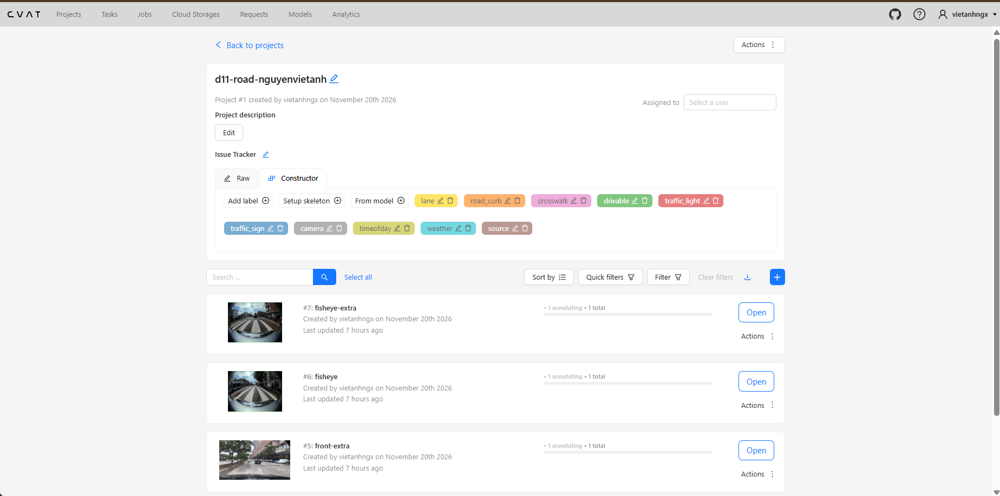
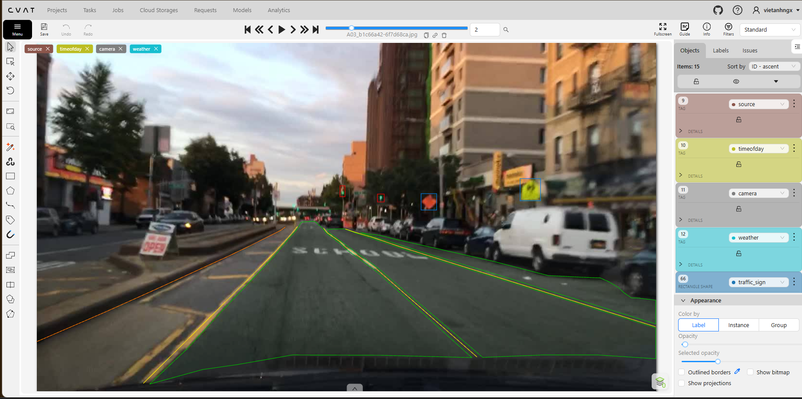
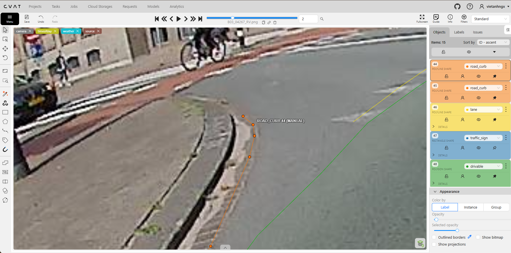
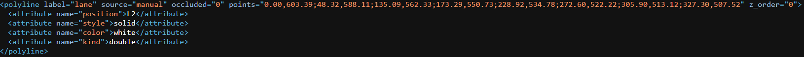

# Báo cáo cá nhân — Ngày 11

**Họ tên:** Nguyễn Việt Anh

**Mã học viên:** 2A202603095

**Phiên bản CVAT (Help → About):** 2.81.0

**Guideline:** Road v1.0

**Lần nộp (`revision` trong manifest):** 3

**Thời điểm export (ngày giờ trên CVAT):** 09:44 ngày 21/11/2026 (UTC+7)

**Số lần nộp lại sau Rework:** 2

## 1. Kiểm project

| Mục | Đúng như guideline Road v1.0? | Ghi chú |
| --- | --- | --- |
| 6 label, đúng kiểu | Có | Khớp cấu hình Road v1.0. |
| Thuộc tính và giá trị | Có | Khớp taxonomy trong repo. |
| 4 tag ảnh | Có | Đủ 4 tag trên 28 ảnh. |
Cách kết thúc polyline trên bản CVAT này: Nhấn N.  
Cách đặt tag ảnh trên bản CVAT này: Chọn công cụ Tag, thêm lần lượt 4 tag rồi chỉnh giá trị trong Objects → Details.  

## 2. Số lượng đã gán

| Task | Ảnh | lane | road_curb | crosswalk | drivable | traffic_light | traffic_sign |
| --- | ---: | ---: | ---: | ---: | ---: | ---: | ---: |
| front | 12 | 42 | 13 | 10 | 33 | 35 | 32 |
| front-extra (đã làm 4 / 4) | 4 | 13 | 3 | 3 | 12 | 9 | 15 |
| fisheye | 8 | 9 | 8 | 9 | 12 | 3 | 4 |
| fisheye-extra (đã làm 4 / 4) | 4 | 1 | 3 | 4 | 4 | 0 | 0 |

## 3. Bảng ca khó

| Ảnh | Nhãn | Phân vân giữa | Đã chọn | Lý do |
| --- | --- | --- | --- | --- |
| A05 | lane | Vẽ thêm L1/R1 hoặc không gán | Không vẽ thêm | Không thấy vạch sơn rõ; áp dụng hướng dẫn coach: không vẽ thêm vạch không có. |
| A06 | lane | Vẽ thêm R1 hoặc không gán | Không vẽ thêm | Không thấy vạch R1; áp dụng hướng dẫn coach, không vẽ thêm. |
| A09 | lane | Vẽ thêm R1 hoặc không gán | Không vẽ thêm | Chỉ thấy mép đường/bó vỉa, không thấy R1; áp dụng hướng dẫn coach. |
| A14 | lane | Vẽ thêm R1 hoặc không gán | Không vẽ thêm | Không thấy R1; giữ road_curb theo hướng dẫn coach. |
| B12 | lane | Giữ đoạn ngắn hoặc kéo dài | Giữ polyline 2 điểm | Chỉ thấy một đoạn vạch thật ngắn; không kéo dài ngoài phần thấy được. |
| B11 | Tag ảnh | Chỉ gắn tag hoặc vẽ thêm shape | Chỉ gắn 4 tag | Ảnh chủ yếu là ô đỗ; vạch ô đỗ không gán lane theo Road v1.0. |

## 4. Phiếu QC 1 nhận được

Bạn kiểm lô của tôi: Lưu Nhật Nam (kiểm chéo).  
Quyết định nhận được: Release (kiểm chéo; chưa chấm với GT).  

| Mã lỗi | Số lỗi | Đồng ý? | Đã sửa? |
| --- | ---: | --- | --- |
| QC1-01 (lần 1) | 2 | Có | Đã sửa tag A15, B06. |
| QC1-03 (lần 1) | 6 | Có | Đã sửa position lane ở B05–B08, B12. |
| QC1-04 (lần 2) | 0 xác nhận | Rút nghi vấn | B03: vệt trắng có thể là túi bóng; giữ nguyên L1. |
| QC1-09 (lần 2) | 1 | Có | Đã kiểm revision 3: đèn A06 là pedestrian / unknown / side. |
| QC1-02 (lần 2) | 5 cảnh báo | Không tính lỗi sau kiểm chéo | Đã xác nhận không thấy vạch; không vẽ thêm. |

## 5. Kiểm file export

| File | Mở lại được? | Số shape ảnh 1 (job / file) | Số shape ảnh 2 (job / file) | Tag camera có trong XML? |
| --- | --- | --- | --- | --- |
| nguyenvietanh-front.zip | Có | A01: 10 / 10 | A02: 7 / 7 | Có |
| nguyenvietanh-fisheye.zip | Có | B01: 6 / 6 | B02: 3 / 3 | Có |

## 6. Ảnh chụp màn hình

1. Tab Labels của project.

   

2. Một ảnh camera trước đã gán đủ (làn, vùng lái, đèn/biển).

   

3. Một ảnh fisheye đã gán, phóng to đoạn polyline cong.

   

4. Một đoạn XML có `<polyline label="lane">`.

   

## 7. Tự đánh giá

Lỗi bạn mắc nhiều nhất hôm nay (theo mã QC1-xx), và cách tránh ở Ngày 20: Gán sai thuộc tính lane và đèn giao thông (QC1-03, QC1-06, QC1-08, QC1-09). Cách tránh: mở Details, kiểm lại từng thuộc tính sau khi vẽ.  
Nhãn của bạn đi vào model ở đâu? Chọn một lỗi đã sửa và nói nó làm model học sai thế nào: Nhãn là đích huấn luyện. Sai màu vạch khiến model học nhầm màu; đã sửa vạch vàng bị gán trắng ở A01.  

## 8. (Tùy chọn, buffer) Từ polyline đến đích row-anchor

| y | 720 | 680 | 640 | 600 | 560 |
| --- | ---: | ---: | ---: | ---: | ---: |
| x của chúng tôi | Không thực hiện | Không thực hiện | Không thực hiện | Không thực hiện | Không thực hiện |
| x của bạn kia | Không thực hiện | Không thực hiện | Không thực hiện | Không thực hiện | Không thực hiện |

Trả lời 3 câu:

1. Năm số x đó chính là đích mà một model row-anchor học cho vạch này. Nếu bạn dừng polyline sớm 40 px, hàng nào đổi thành "không có làn"?  
Không thực hiện phần tùy chọn này.
2. So với bạn được kiểm (cùng ảnh): ở hàng 720 và hàng 560, hai bạn lệch nhau bao nhiêu pixel? Lệch ở hàng nào ảnh hưởng LKA nhiều hơn (slide 25)?  
Không thực hiện phần tùy chọn này.
3. Nếu polyline vẽ từ xa về gần (ngược quy tắc 2), cách tính trên có đổi không? Script nào sẽ gặp khó?  
Không thực hiện phần tùy chọn này.
